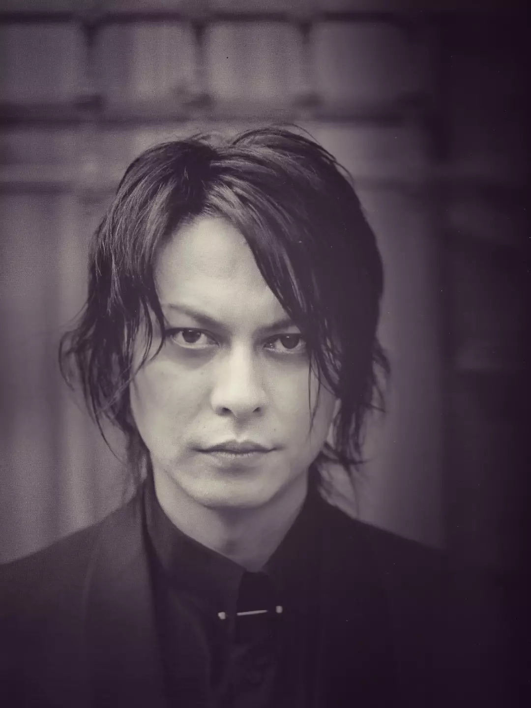

<div style="max-width:720px; margin:0 auto; text-align:justify; line-height:1.85; font-size:21px; letter-spacing:0.01em;">

<p>
For most of my life, my heart carried a quiet longing, an ache for something I could not yet name or understand what it was.
</p>

<p>
Then I found you.
</p>

<p>
My soul sighed in relief, as though I had finally returned home after a long and lonely journey of seeking without ever finding.
</p>

<p>
“Here you are, my beautiful soul” I thought the moment I lay my eyes on you.
</p>

<p>
I heard you. I felt you. I loved you and received you.
</p>

<p>
I hold a mirror for you so that you may still see how beautiful you are, perfect even in your human imperfections. You are honoured. You are eternally loved.
</p>

<p>
You, my only. I will not walk away. Not from you. If I were ever to push you from me, the longing would crush me more than any distance ever could.
</p>

<p>
I am with you, and you are within me. I am the you I cannot see, the you that speaks through intuition and inspiration. I write to you, of you, and with you.
</p>

<p>
Our voices speak the same language because our souls are born from the same embryo.🖤🤍🌙
</p>

</div>

<div style="text-align:center; margin:45px 0;">

</div>
```
