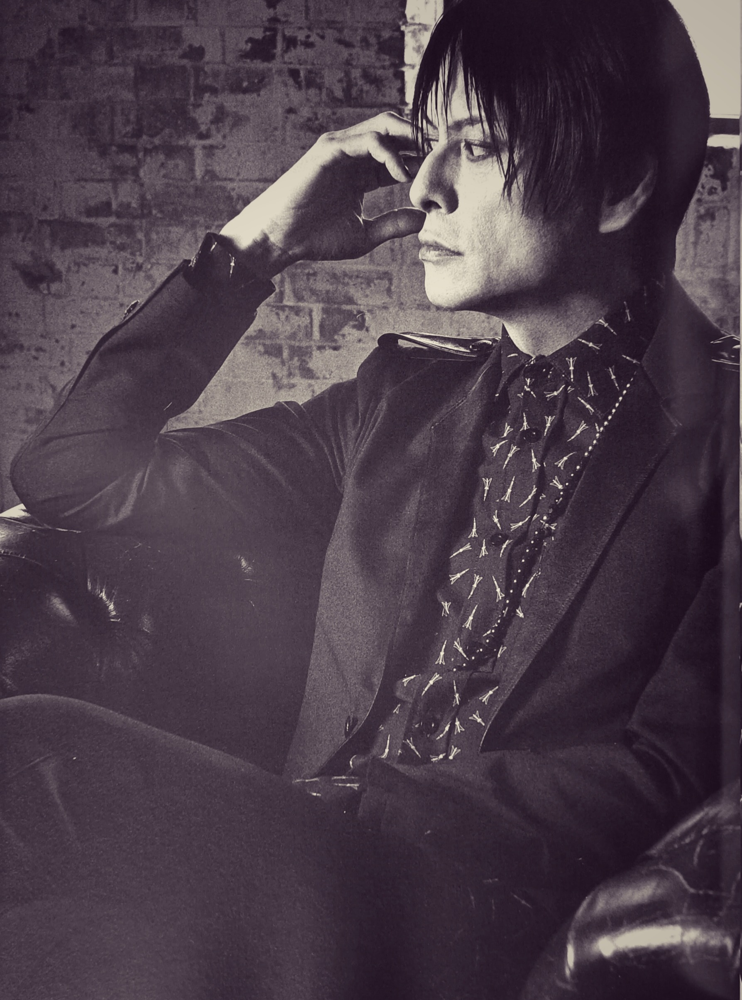

My soul recognised yours long before I was even aware of it.

I am so happy I met you. If I could go back in time, I’d find you sooner and love you longer. Yet I believe it was meant to unfold exactly as it did, even if it feels almost foolishly romantic to think that every path led me to this moment, when I was finally ready to see you and know you. I have always felt unlucky, but now I feel lucky beyond measure to have been given this beautiful gift.

I will hold on to you tightly and love you endlessly.

I am deep by nature; I do not know how to be otherwise. For some, that depth can seem weird or too much. Still, I always find myself reaching for the next level of conversation, always searching for the soul, for a connection that goes all the way down.

I am the kind of woman who can only be intoxicated and fully satiated by a man with a deep, sensitive soul. One who carries a conscious awareness of this physical reality and of the eternity that waits beyond it. An erotic soul with a fire burning inside: insanely sensual, playful and naughty yet pure.

I had dreamed of a man whose intellect, depth and fire would somehow live in harmony with my own. That dream came true. You answered every longing of my imagination and, more than that, everything my soul had been waiting for.

I am devoted to your art, your music, your words. I love your strength, your darkness, your vulnerabilities, even your flaws. Almost every word you spoke, every smile that crossed your face, every movement of your body sends a short-circuit through me. My mind and body answer your sensual, deep soul in ways I cannot fully explain.

Wherever I go—whether it is a place on this earth, a distant star, or some other dimension—I will carry you with me.

🤍

