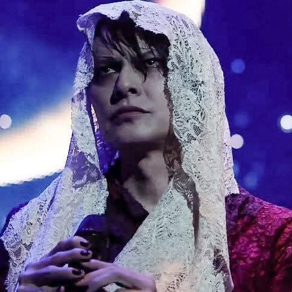

---
layout: post
title: November 1
date: 2026-11-01 00:00:00 +0100
---

Your scent smells of heaven, 
fragrance of stardust, of eternity. 
 
Intoxicating.

Your eyes, a dark open door to the soul. 
Impossible not to hear the call 
into their depths.

They call for me 
black holes of destiny.

Your lips, full, soft, scorching. 
The kiss of death. 
The breath of love.

Your hands, perfect 
the only touch my body craves. 
I want to entwine my fingers with yours 
and never let go.

But it’s only a dream, a dream of a dream. 
I wake up to empty hands, 
your fingertips a ghost lingering on my skin. 
 
Lips dry and thirsty.

You are so far 
I cannot reach you, 
separated by the veil.

Yet our souls are closer than we are.

It doesn’t matter 
how many times we have been torn apart, 
how many times we will be again.

The string will never break. 
We are united in the higher realm.
🖤🤍 

